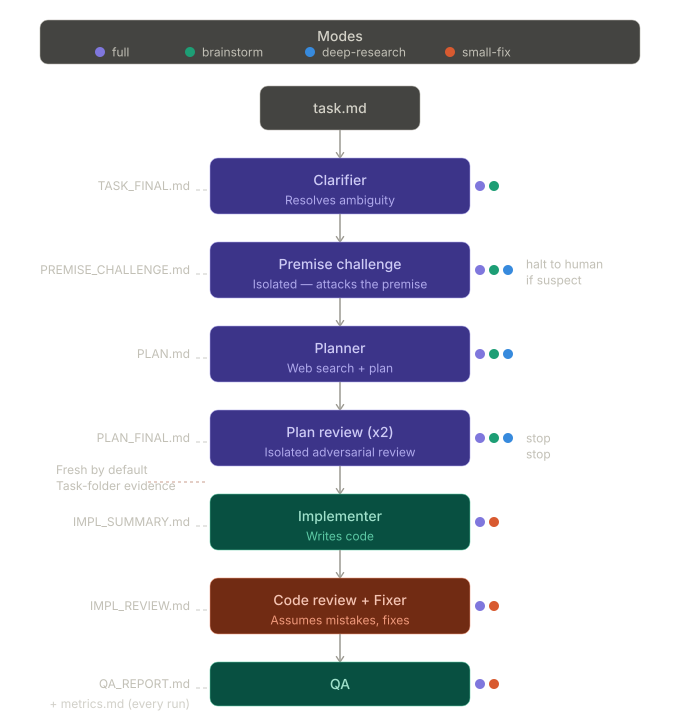

<p align="center">
  <picture>
    <source media="(prefers-color-scheme: dark)" srcset="assets/logo/maw-lockup-dark.png">
    
  </picture>
</p>

<p align="center"><a href="README.md">English</a> · <b>Русский</b></p>

# MAW — Multi-Agent Workflow для Claude Code и Codex CLI

**Правила в промпте говорят модели, что делать. MAW добавляет слой проверки на случай, когда она их не слушает.**

MAW — набор скиллов, который проводит задачу по коду через цепочку независимых агентов. Каждый агент проверяет работу предыдущего по реальному коду, а не по его пересказу, и исходит из того, что предыдущий ошибся. MAW не заменяет правила в промпте вроде принципов Карпатого, а дополняет их: ловит то, что проскакивает несмотря на правила.

| Подход | Как работает | Где ломается |
|---|---|---|
| Правила в промпте | Агенту говорят "будь аккуратен" | На сложном контексте агент отходит от правил |
| Самопроверка | Агент проверяет свою же работу | Ошибку проверяют те же слепые зоны, которые её допустили |
| **MAW** | Независимые агенты проверяют по коду | Ревьюеры не видят разговор с автором и смотрят сам код |

## Быстрый старт

```bash
curl -fsSL https://raw.githubusercontent.com/pockerhead/maw/main/install.sh | sh
```

Установщик находит `claude` и `codex` и настраивает MAW для каждого найденного. На Windows запускайте из Git Bash. **После установки перезапустите харнесс**: скиллы и сабагенты подхватываются только при старте сессии.

Для Claude Code добавьте скиллы в `CLAUDE.md` проекта:

```markdown
## Skills
@.claude/skills/maw-execute-task/SKILL.md
@.claude/skills/maw-tasks/SKILL.md
@.claude/skills/maw-context/SKILL.md
```

Потом опишите работу и запустите:

```
/maw-tasks "fix 404 on the profile page"   # MAW предложит режим, вы подтверждаете
/maw-execute-task                          # берёт задачу с наивысшим приоритетом
```

В Codex нет своих слэш-команд, поэтому просите словами: "run maw-execute-task for task 3".

Флаги установки, обновление и заметки по Windows: [docs/INSTALL.md](docs/INSTALL.md). Все команды и флаги: [docs/USAGE.md](docs/USAGE.md). Документация в `docs/` пока на английском.

## Как это работает



- **Свежие агенты.** История разговора не переходит между этапами. Всё передаётся через папку задачи.
- **Недоверие по умолчанию.** Каждый агент считает предыдущего ненадёжным. Скептичен, но не враждебен.
- **Проверка постановки.** До планирования изолированный агент проверяет, не ошибочна ли сама постановка задачи, и если да, останавливается и зовёт человека.
- **Задачи — это папки.** Статус задачи определяется папкой, в которой она лежит: `pending/`, `in_progress/`, `done/` или `blocked/`. Работа идёт в отдельной ветке или в git worktree.

Подробности устройства: [docs/ARCHITECTURE.md](docs/ARCHITECTURE.md).

## Режимы

Не каждой задаче нужен весь конвейер.

| Режим | Этапы | Для чего | Токены | Стоимость (Sonnet) |
|---|---|---|---|---|
| `full` | Clarifier → Premise Challenge → Planner → Plan Review ×2 → Implementer → Code Review → Fixer → QA | Фичи, миграции, авторизация, платежи | 280–560k | $1–4 |
| `small-fix` | Implementer → Code Review → Fixer → QA | Баги с понятными границами | 120–200k | $0.5–1.5 |
| `brainstorm` | Clarifier → Premise Challenge → Planner → Plan Review ×2 | Разбор подходов до написания кода | 100–180k | $0.4–1.2 |
| `deep-research` | Premise Challenge → Planner (веб-поиск) → Plan Review ×2 | Сравнение решений, аудит подходов | 80–150k | $0.3–1 |

Простое правило: если баг в проде обойдётся дороже прогона конвейера, используйте MAW. Opus дороже, этапы на Codex оплачиваются по вашему тарифу Codex. Подробно о стоимости: [docs/USAGE.md](docs/USAGE.md#cost).

## Что вы получаете

Каждый прогон оставляет след в папке задачи:

```
maw/tasks/done/TASK-001/
├── TASK_FINAL.md          уточнённые требования
├── PREMISE_CHALLENGE.md   проверка постановки
├── PLAN_FINAL.md          план после двух ревью
├── IMPL_SUMMARY.md        что реализовано
├── IMPL_REVIEW.md         замечания ревью кода
├── FIX_SUMMARY.md         что исправлено
├── QA_REPORT.md           результаты проверки
└── metrics.md             токены, вызовы инструментов и время по агентам
```

Полный список для каждого режима: [docs/USAGE.md](docs/USAGE.md#what-gets-produced).

## Любой этап на Claude или Codex

У каждого этапа может быть свой провайдер, модель и уровень усилия. Например, ревью кода на Codex, а всё остальное на Claude: у ревьюера от другого вендора другие слепые зоны.

```json
{
  "agents": {
    "code-reviewer": { "provider": "codex", "model": "gpt-6.1-sol", "effort": "xhigh" }
  }
}
```

Недопустимая пара модели и уровня усилия останавливает прогон, а не понижается молча. Межпровайдерный режим пока экспериментальный. Все настройки: [docs/CONFIGURATION.md](docs/CONFIGURATION.md).

## Другие скиллы

- **`/maw-selfreview`**: одноэтапное ревью вашего собственного staged-диффа моделью другого вендора, запускается pre-commit-хуком. Только Claude Code. [docs/SELFREVIEW.md](docs/SELFREVIEW.md)
- **`/maw-reason`** (экспериментальный): состязательное обсуждение вопроса, а не задачи. Пять изолированных ролей, в конце синтез с явным списком разногласий. Только Claude Code. [docs/REASON.md](docs/REASON.md)
- **`/maw-context`**: необязательные знания о проекте (инварианты, домены, инструменты), которые подаются агентам. [docs/PROJECT_CONTEXT.md](docs/PROJECT_CONTEXT.md)

## Что измерено

Цифры из реального использования, оговорки в [docs/RESULTS.md](docs/RESULTS.md):

- **Этап ревью возразил в 39,3% задач**, где был вердикт (70 из 178).
- **Fixer понадобился второй раунд в 5,3% задач** (9 из 169), так что ревью редко превращается в цикл.
- **SWE-bench Multilingual: решено 7 из 12 запущенных задач** на Sonnet в режиме `small-fix`. Сравнения с одиночным агентом на той же модели нет, поэтому это точка данных, а не заявка на превосходство.
- **В 15,3% задач хотя бы один агент упал** без вердикта (ошибки API, таймауты, принудительные остановки).

## Сравнение

| | MAW | Claude Forge | adversarial-dev | Forge AI | adversarial-review (ng) |
|---|---|---|---|---|---|
| Подход | Последовательный состязательный | Циклы в стиле GAN | GAN-харнесс из 3 агентов | Конкурирующие архитекторы + судья | Консенсус двух агентов |
| Охват | Задача → QA (полный цикл) | Фича + аудит + документация | Планирование → сборка → оценка | Планирование + выполнение | Только ревью кода |
| Режимы | 4 (full, small-fix, brainstorm, deep-research) | brainstorm + audit | — | флаг --fast | Отсечение по оценке диффа |
| Учёт задач | Встроенный (pending/done/blocked) | Нет | Нет | Нет | Нет |
| Провайдер | Claude Code + Codex CLI (по этапам) | Claude Code | Claude SDK + Codex SDK | Claude/Codex/Cursor/API | Claude Code |
| Установка | Один curl | cp -r | git clone + pip | pip install | /plugin marketplace |

Ниша MAW: полный жизненный цикл со встроенным учётом задач, контролем стоимости через режимы и выбором провайдера на каждом этапе. Если нужно только ревью кода, ng/adversarial-review сфокусирован лучше.

## Лицензия

MIT
