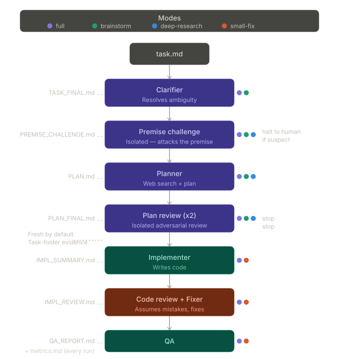

# Architecture

## The problem

You can paste the best coding guidelines into your system prompt. The LLM will read them, agree they're important, and then drift from them under complex context. An agent that writes code and reviews its own output has the same blind spots in both passes.

Compare:

| Approach | How it works | Failure mode |
|---|---|---|
| Prompt rules (Karpathy-style) | Tell the agent "be careful" | Agent drifts from rules under complex context |
| Self-review | Agent checks its own work | Same blind spots that caused the error review the error |
| **MAW** | Independent agents verify against code | Reviewers get no shared conversation and verify code plus searchable evidence; the premise audit and both plan reviews are additionally isolated from prior transcripts and the log |

## Pipeline

*(The diagram shows the stage flow; the provider dispatch layer — which harness runs each stage — is described in [CONFIGURATION.md](CONFIGURATION.md).)*

Key design decisions:
- **Fresh by default, evidence shared through the task folder** — no conversation history crosses a stage. Agents can search harness-written transcripts, reuse executable evidence in scratch, and append only decisions or dead ends to a minimal log. Native continuity exists only for same-profile timeout/transient retries and an implementer re-run after the user amends a `PLAN_BLOCKED` plan; no premise, plan, code, fixer, or QA judging role is ever continued.
- **Adversarial by default** — each agent's prompt includes the assumption that the previous agent was unreliable. Not hostile, but skeptical.
- **Premise challenge** — before planning, an isolated agent fed only the task and the real system (never the orchestrator's framing, the plan, or any summary) tests whether the *premise itself* is wrong, and halts to the human if it is. Every other stage verifies the solution within the premise and inherits its lineage; this is the one structural check that attacks the frame. It reduces — does not eliminate — the "pipeline faithfully executes a wrong premise" failure; the human remains the last line.
- **Absence check** — checking claims finds what an artifact says wrongly, not what it leaves out. Both plan reviewers, the code reviewer, and QA therefore end with an `## Absence check` table: a set difference between an independent list they build themselves (call sites, enum variants, routes, declared operations) and what the plan or diff covers, or one concrete mutation that would keep the tests green while behaviour is wrong. An empty result is a valid answer. A finding blocks only with code-level evidence (`file:line`, a diff output, a mutation result). The next stage (plan-reviewer-2 for the first plan review, the fixer for the code review) records each finding as confirmed, disputed with evidence, mechanism corrected, or prescription recomputed. A reviewer's suggested fix is not binding: field runs showed a correct diagnosis paired with a fix that would have broken correct production code. `metrics.md` carries the counts. A narrative pre-mortem ("assume it failed in production, tell the story") is left out on purpose: it is the least evidence-bound form and pushes reviewers towards over-engineering. Projects can experiment with it in their `PCTX` overlay.
- **Claims before code carry their check** — a project's ledger of about 1000 prediction/outcome pairs showed claims made before code (planner, orchestrator) holding about 30% of the time, and claims checked against code or a run (code review, QA) holding 55–80%. In that ledger the gap tracked whether a claim rested on evidence, not which role made it. Published studies agree: agents overestimate their own success, and external checks with tools work where self-critique does not. The planner therefore marks any claim it has not checked as `[unverified]` and names the check. Plan reviewers settle those claims first, and the implementer's pre-flight runs any that remain. Estimates are hypotheses, not acceptance thresholds. Notes the orchestrator adds to a spawn prompt arrive labelled as hypotheses, and a stage may reject them with evidence.
- **Task-local state** — artifacts live in the task folder on a feature branch. Text artifacts and scratch source follow normal `maw/` persistence; privacy-sensitive transcript payloads are deliberately gitignored and rescued locally before worktree removal.

Back to the [README](../README.md).
